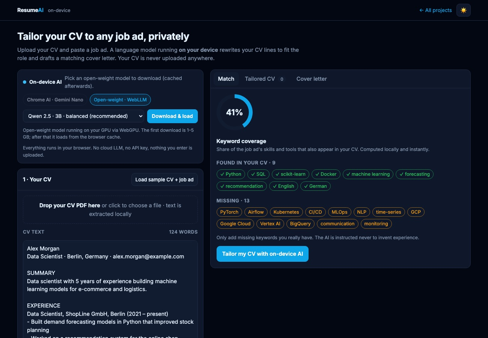

# Resume AI

Tailor your CV to a specific job ad and get a matching cover letter. Upload your CV (PDF) and paste the job description: Resume AI shows how well the two match, rewrites individual CV lines in the job ad's vocabulary (without inventing experience) and drafts a cover letter, exported as PDF or Word.

**Who it's for:** job seekers who send many applications and want each CV to fit the role, without uploading their CV to a third-party service.

**Live demo:** https://shawaiz.de/demos/resume-ai/ runs entirely in your browser with an on-device language model. No account, no API key, nothing uploaded.



## Two versions

| | Web demo (`docs/`) | Server app (`client/` + `server/`) |
|---|---|---|
| Runs | In the browser, on-device | Docker: Next.js frontend + Flask API |
| Language model | Chrome built-in AI (Gemini Nano) or open-weight models via WebLLM/WebGPU (Qwen 2.5, Llama 3.2) | OpenAI API (key in a local `.env`) |
| CV parsing | pdf.js | PyMuPDF |
| Output | Keyword match, line-by-line suggestions, cover letter → PDF (jsPDF) / Word | Optimized CV written back into the original PDF layout + cover letter → PDF/DOCX |
| Privacy | CV never leaves the device | CV is sent to your own server and the LLM provider |

## Built with

- **Web demo:** plain HTML/CSS/JavaScript, [pdf.js](https://mozilla.github.io/pdf.js/), [WebLLM](https://github.com/mlc-ai/web-llm), Chrome Prompt API, [jsPDF](https://github.com/parallax/jsPDF)
- **Server:** Python 3.8, Flask, PyMuPDF, pdf2docx, fpdf, OpenAI SDK; Next.js 13 + React 18 frontend; Docker

## How to run

### Web demo (no setup)

Open https://shawaiz.de/demos/resume-ai/, or locally:

```bash
cd docs
python3 -m http.server 8080   # then open http://localhost:8080
```

Use a desktop Chrome or Edge. In the "On-device AI" panel, either download Chrome's Gemini Nano or pick an open-weight model (downloaded once, then cached). Click **Load sample CV + job ad** to try it with fictional data.

### Server app (Docker)

```bash
cp .env.example .env          # add your own OpenAI key; .env is gitignored
docker build -t resume-generator .
docker run --env-file .env -p 3000:3000 -p 8000:8000 resume-generator
```

Frontend: http://localhost:3000 · API: http://localhost:8000

## Privacy and data

- The repository contains only fictional sample data. Generated and uploaded CVs (`server/docs/`, `client/app/server/public/`) are gitignored.
- Secrets live only in a local `.env` (see `.env.example`).

## Roadmap

See [ROADMAP.md](ROADMAP.md).

## License

[MIT](LICENSE) © Shawaiz Shah
